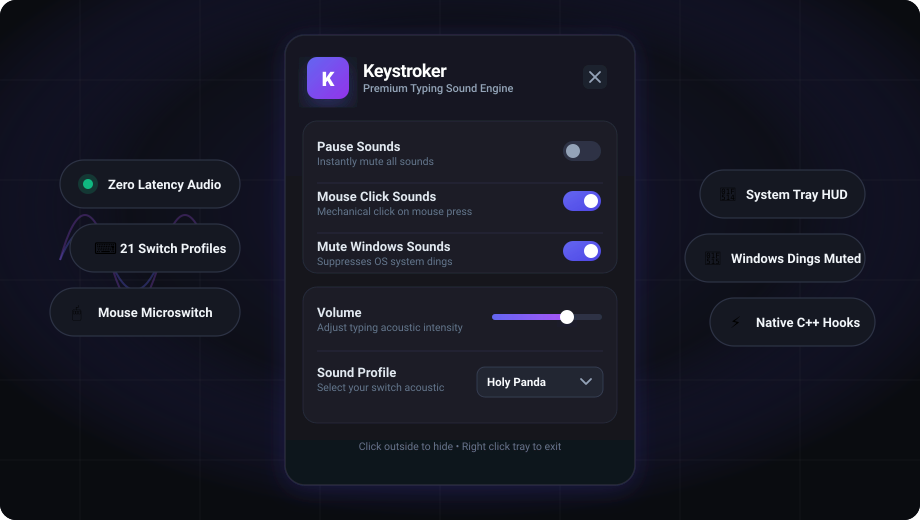
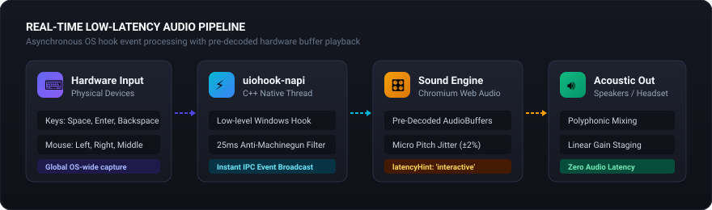
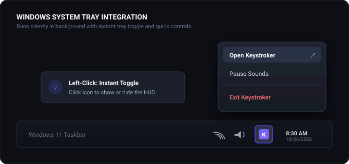
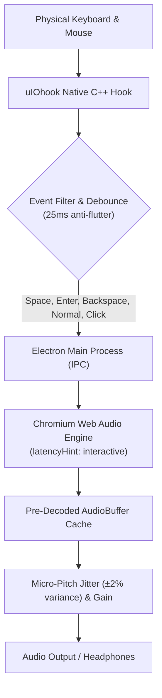

<div align="center">


# Keystroker

A low-latency mechanical keyboard and mouse click sound engine for Windows.

[](LICENSE)


<p align="center">
  
</p>

[About](#about) • [Features](#features) • [Screenshots](#screenshots) • [Sound Profiles](#sound-profiles) • [How It Works](#how-it-works) • [Installation](#installation) • [Usage](#usage) • [Building from Source](#building-from-source) • [Configuration](#configuration) • [Contributing](#contributing) • [License & Credits](#license--credits)

</div>

---

## About

Keystroker is a lightweight background application for Windows that plays high-fidelity mechanical keyboard and mouse click acoustics in real time as you type and click. Using low-level native OS hooks and Chromium's Web Audio API with pre-decoded audio buffers, it triggers switch acoustics with imperceptible sub-millisecond latency across every application, code editor, browser, and game. It runs quietly in the system tray, features a modern floating dark-mode HUD, and operates 100% offline with zero telemetry or keystroke logging.

---

## Features

- **Global OS-Wide Interception**: Low-level event hooks via `uiohook-napi` capture keystrokes and mouse presses across all active windows and full-screen games without requiring window focus.
- **Sub-Millisecond Web Audio Engine**: Employs an interactive Web Audio pipeline with pre-decoded PCM `AudioBuffer` memory caching and unthrottled background playback (`backgroundThrottling: false`).
- **21 Curated Sound Profiles**: Ships with 21 switch libraries spanning mechanical classics (Topre, Holy Panda, Cherry MX, Model M), manual typewriters, retro arcade synths, and novelty clicks.
- **Tactile Mouse Click Feedback**: Intercepts mouse button presses and triggers authentic microswitch acoustic samples with dynamic pitch scaling.
- **Natural Organic Micro-Jitter**: Injects `±0.02` random playback-rate variance into each strike to mirror genuine mechanical switch variance and avoid repetitive auditory fatigue.
- **Floating Tray HUD**: Frameless, draggable glass interface that snaps near the Windows notification area and automatically dismisses when you click away.
- **Windows Alert Suppressor**: Integrated helper script to silence default Windows navigation clicks and alerts (`explorer.exe`) while typing.

---

## Screenshots

<p align="center">
  
  <br /><em>Floating HUD: Instant sound profile switching, smooth volume control, and fast toggles for pause, mouse clicks, and Windows sound suppression.</em>
</p>

<p align="center">
  
  <br /><em>Audio Pipeline: Hardware interrupt handling, debouncing, key classification, and pre-decoded memory buffer playback.</em>
</p>

<p align="center">
  
  <br /><em>System Tray: One-click tray toggle to show or hide the HUD, with quick pause and exit controls in the context menu.</em>
</p>

---

## Sound Profiles

Keystroker includes 21 sound profiles out of the box. Each profile maps dedicated acoustic samples for standard alphanumeric keys, spacebar, enter, backspace, and mouse clicks:

| Category | Profile | Acoustic Signature |
| :--- | :--- | :--- |
| **Mechanical Enthusiast** | **Topre** | Deep, rounded electro-capacitive tactile thock |
| | **Holy Panda** | Snappy, tactile clack with prominent bottom-out |
| | **Thocky** | Deep, dampened acoustic profile favored in custom builds |
| | **Gateron Ink Black** | Smooth linear switch acoustic with clean bottoming |
| | **Mechanical** | Universal balanced mechanical switch acoustic |
| **Cherry MX Family** | **Cherry MX Blue** | Crisp, high-pitched mechanical click with tactile bump |
| | **Cherry MX Brown** | Subtle tactile clack without click-bar resonance |
| | **Cherry MX Red** | Smooth, quiet linear travel with light switch report |
| | **Clicky** | Sharp, pronounced acoustic snap for tactile typing purists |
| **Vintage & Typewriters** | **IBM Model M** | Iconic buckling spring snap from classic computing |
| | **Typewriter Vintage** | Heavy mechanical carriage and steel hammer strikes |
| | **Typewriter Modern** | Crisp mid-century manual typewriter clack |
| | **Typewriter** | Classic typewriter keys with resonant body tone |
| **Digital & Retro** | **Opera GX** | Punchy digital feedback inspired by high-energy gaming browsers |
| | **8-Bit Retro** | Chiptune synth clicks reminiscent of 80s arcade cabinets |
| | **Hacker Terminal** | Cyberpunk sci-fi console keystroke acoustics |
| | **Sci-Fi Blaster** | Futuristic energy pulses on every keypress |
| **Novelty & Ambient** | **Water Drops** | Calming, resonant liquid droplet sounds |
| | **Wooden Blocks** | Hollow, woody percussive strikes with warm resonance |
| | **Soft** | Gentle, muted tap suited for late-night typing and shared rooms |
| | **Cheap Membrane** | Nostalgic recreation of vintage office rubber-dome keyboards |

---

## How It Works

Keystroker bridges low-level C++ native OS hooks with Chromium's Web Audio subsystem:



1. **Native Interception**: `uiohook-napi` runs in a native thread to capture raw keyboard and mouse events globally.
2. **Debounce & Classification**: Events within a 25ms window are debounced to prevent stuttering on held keys, and classified into key types (`normal`, `space`, `enter`, `backspace`, `click`).
3. **Pre-Decoded Playback**: When a sound profile is chosen, audio files are pre-decoded into raw PCM `AudioBuffer` memory. Strikes trigger immediate hardware audio playback without disk I/O.
4. **Unthrottled Background Execution**: `backgroundThrottling: false` ensures Chromium's renderer does not sleep or drop frames when the application window is hidden or unfocused.

---

## Installation

### Windows Installer (Recommended)

1. Download the latest `Keystroker-Setup-0.1.0.exe` from [Releases](https://github.com/projectGloria/Keystroker/releases).
2. Run the installer.
3. Launch Keystroker from your Start Menu or Desktop shortcut. The application will start and place an icon in your Windows system tray.

### Requirements

- **Operating System**: Windows 10 or Windows 11 (64-bit)
- **Audio Output**: Any standard stereo headphones or speakers

---

## Usage

### Basic Controls

- **Open / Hide HUD**: Left-click the Keystroker tray icon in the Windows notification area, or click the `✕` button to hide it.
- **Dismiss**: Click anywhere outside the HUD window to hide it back to the tray.
- **Reposition**: Drag the top header bar to place the floating window anywhere on your screen. The position is remembered automatically.
- **Switch Profile**: Select any switch profile from the dropdown list.
- **Adjust Volume**: Slide the volume slider between 0% and 100%.
- **Pause Audio**: Toggle the **Pause Sounds** switch in the HUD, or right-click the tray icon and select **Pause Sounds**.
- **Exit**: Right-click the system tray icon and click **Exit**.

---

## Building from Source

### Prerequisites

- [Node.js](https://nodejs.org/) (v18.x or newer; v20+ recommended)
- [Python](https://www.python.org/) (required by `node-gyp` to compile native C++ modules)
- Visual Studio C++ Build Tools (Desktop development with C++)
- [Git](https://git-scm.com/)

### Steps

1. **Clone the repository:**
   ```powershell
   git clone https://github.com/projectGloria/Keystroker.git
   cd Keystroker
   ```

2. **Install dependencies:**
   ```powershell
   npm install
   ```

3. **Run development mode:**
   ```powershell
   npm run dev
   ```
   *Starts the Vite dev server on `http://localhost:1420` and launches Electron with live reload.*

4. **Package the Windows installer:**
   ```powershell
   npm run build:win
   ```
   The production installer will be generated in the `release/` directory:
   ```
   release/Keystroker-Setup-0.1.0.exe
   ```

---

## Configuration

Keystroker stores its persistent configuration in your Windows user profile at:

```
%APPDATA%\keystroker\keystroker-settings.json
```

### Settings Schema

```json
{
  "profile": "Topre",
  "volume": 0.5,
  "paused": false,
  "muteSystem": false,
  "mouseClicks": true
}
```

<details>
<summary><strong>Troubleshooting: Mute Windows Sounds</strong></summary>

The optional **Mute Windows Sounds** toggle executes `mute_sys.py` using Windows Core Audio APIs via `pycaw`. If you want to use this feature when running from source:

1. Ensure Python is added to your system `PATH`.
2. Install the `pycaw` package:
   ```powershell
   pip install pycaw
   ```

</details>

---

## Contributing

Contributions, sound profiles, and bug fixes are welcome!

1. Fork the repository.
2. Create a feature branch:
   ```powershell
   git checkout -b feature/new-sound-profile
   ```
3. Commit your changes:
   ```powershell
   git commit -m "Add new sound profile"
   ```
4. Push to your branch and open a Pull Request.

---

## License & Credits

Keystroker is open-source software licensed under the [MIT License](LICENSE).

- **Architecture**: [Electron](https://www.electronjs.org/), [React 19](https://react.dev/), [TypeScript](https://www.typescriptlang.org/), and [Vite](https://vitejs.dev/).
- **Native Hooking**: [uiohook-napi](https://github.com/Tolik518/uiohook-napi) by Tolik518.
- **Audio Synthesis & Samples**: Pre-processed and balanced for low-latency desktop reproduction.
- **Author**: Created by [Nihil](https://github.com/projectGloria).
